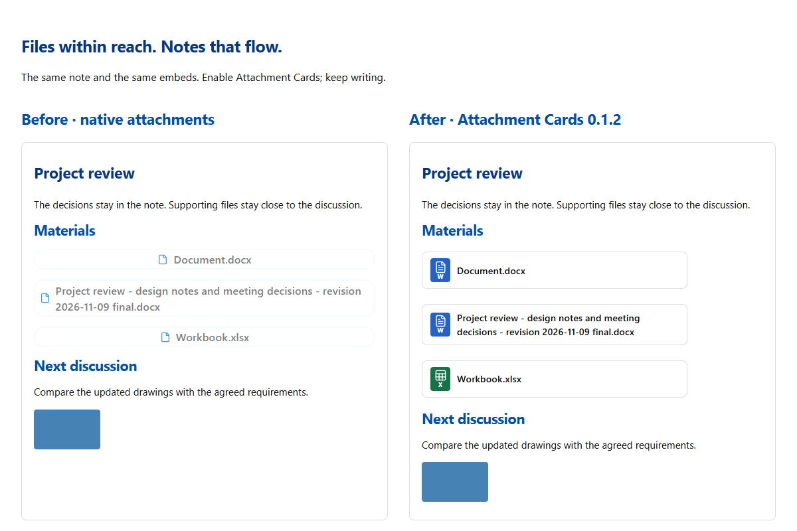

# Attachment Cards

Keep supporting files close without letting them take over your notes.

Turn PDF, Word, Excel and other document embeds into compact, recognizable file cards. Your existing `![[file]]` embeds work immediately—no new syntax, conversion or setup. Click a card to open its file.

[中文说明](README.zh-CN.md)



Meeting notes with shared materials. Course notes with handouts. Project notes with deliverables. Keep the discussion readable and its files easy to find.

## Install

In Obsidian, open **Settings → Community plugins → Browse**, search for **Attachment Cards**, then select **Install** and **Enable**.

[Open in Obsidian](obsidian://show-plugin?id=attachment-cards) · [Community listing](https://community.obsidian.md/plugins/attachment-cards)

Open a note containing a document embed. It becomes a card automatically. Disable the plugin to restore native embeds; the Markdown is unchanged.

## Features

- File-type icons for PDF, Word, Excel, PowerPoint and plain text, plus a generic icon for other attachments.
- Click a card to open the file using Obsidian's normal link handling.
- Works in Reading view and Live Preview. Source mode keeps the original Markdown.
- Short names fit a compact row. Long names wrap in full, keeping dates, revision labels and extensions visible.
- Images, embedded notes, audio and video keep their native display and players.
- File name and type icon only, with no settings to configure.
- No network requests, telemetry or changes to note contents.

| Type | Extensions | Icon color |
| --- | --- | --- |
| PDF | `.pdf` | Red |
| Word | `.doc`, `.docx` | Blue |
| Excel | `.xls`, `.xlsx` | Green |
| PowerPoint | `.ppt`, `.pptx` | Orange |
| Plain text | `.txt` | Slate blue |
| Other attachments | Other non-image, non-note, non-media files | Gray |

## Manual installation

1. Download `main.js`, `manifest.json` and `styles.css` from this repository's **Releases** page.
2. Create an `attachment-cards` folder inside your vault's `.obsidian/plugins/` folder.
3. Place the three files directly inside that folder.
4. Reload Obsidian, then enable **Attachment Cards** under **Settings → Community plugins**.

The three release files are ready to run and require no build step. The ZIP generated by the packaging script also contains these files inside an `attachment-cards/` folder.

## Usage

Use ordinary embeds that point to files in your vault:

```markdown
![[Report.pdf]]
![[Document.docx]]
![[Workbook.xlsx]]
![[Slides.pptx]]
![[Notes.txt]]
![[Archive.zip]]
```

Markdown embeds such as `` also work. Ordinary links such as `[[Report.pdf]]` stay unchanged. Long names wrap without truncation; hover also shows the complete filename. Cards can be opened with Enter or Space when focused. Selecting text across a card does not activate it.

PDF embeds become cards and open through Obsidian; Office files use the system's associated application. Images, audio, video and embedded notes remain native. The plugin does not add file previews, move attachments or rewrite your notes.

## Compatibility

The manifest declares Obsidian 1.5.0 or later. Runtime checks were performed on Windows with Obsidian 1.15.0 and the Blue Topaz theme. Older versions and mobile devices have not been verified. The plugin decorates native embed elements, so future changes to Obsidian's embed markup may require an update.

<details>
<summary>Development and packaging</summary>

`main.js` is both the source and the runtime entry point. `styles.css` contains the scoped card styles. There are no npm dependencies or compilation steps.

```sh
node --check main.js
python scripts/package_release.py
```

Packaging requires Python 3.10+, Node.js and Git. It verifies the version metadata, creates an install ZIP and standalone release assets under `dist/0.1.2/`, and exports the committed source with `git archive`. Commit the finished changes before packaging; the script refuses a dirty repository.

See [publishing instructions](docs/publishing.md) and [runtime verification](tests/README.md).

</details>

## License

[MIT](LICENSE). File icons are provided by Obsidian's built-in Lucide icon API; no icon assets are bundled.

Maintained by [wing-zlatan](https://github.com/wing-zlatan).
