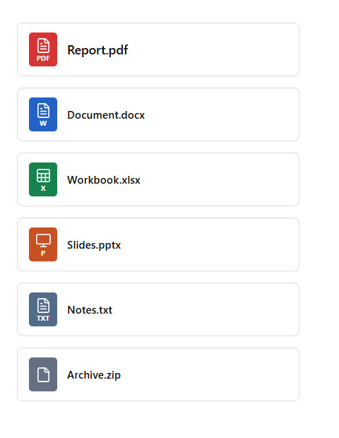

# Attachment Cards

将 Obsidian 中的附件嵌入显示为紧凑、边界清晰的卡片，点击即可打开。保留原有附件语法，不需要修改已有笔记。

[English](README.md)



## 功能

| 类型 | 扩展名 | 图标颜色 |
| --- | --- | --- |
| PDF | `.pdf` | 红色 |
| Word | `.doc`、`.docx` | 蓝色 |
| Excel | `.xls`、`.xlsx` | 绿色 |
| PowerPoint | `.ppt`、`.pptx` | 橙色 |
| 纯文本 | `.txt` | 灰蓝色 |
| 其他附件 | 其他非图片、非笔记文件 | 灰色 |

卡片只显示图标和文件名，不显示大小，不区分预览和打开，也没有设置页面。阅读视图与实时预览均可使用，源代码模式保留 Markdown。图片、笔记及 Canvas 等内容继续使用原生显示。

## 安装

1. 从本仓库的 **Releases** 页面下载 `main.js`、`manifest.json`、`styles.css`。
2. 在笔记库的 `.obsidian/plugins/` 下创建 `attachment-cards` 文件夹，将三个文件放入其中。
3. 重新加载 Obsidian，在“设置 → 社区插件”中启用 **Attachment Cards**。

也可将 `attachment-cards-0.1.1.zip` 解压到 `.obsidian/plugins/`；压缩包已包含 `attachment-cards/` 这一层目录。安装不需要 Node.js、Python 或编译。

## 使用

附件已位于笔记库时，照常插入：

```markdown
![[Report.pdf]]
![[Document.docx]]
![[Workbook.xlsx]]
![[Slides.pptx]]
![[Notes.txt]]
![[Archive.zip]]
```

也支持 ``。普通正文链接 `[[Report.pdf]]` 不变。文件名最多显示两行，悬停可查看完整名称；获得键盘焦点后，Enter 或空格也可打开。

文件沿用 Obsidian 的链接打开方式，Office 文件由系统关联应用打开。停用插件即可恢复原生显示。插件不修改笔记正文，不发送网络请求，不收集使用数据。

## 兼容与开发

manifest 声明最低 Obsidian 版本为 1.5.0，实际检查环境为 Windows、Obsidian 1.15.0 和 Blue Topaz 主题；旧版本与移动端尚未验证。插件装饰原生嵌入节点，Obsidian 更新 DOM 结构后可能需要适配。

源码入口为 `main.js`，样式为 `styles.css`，不需要构建。发布打包方法见 [英文 README](README.md#development-and-packaging)，GitHub 和社区目录的发布步骤见 [发布说明](docs/publishing.md)。

许可证：[MIT](LICENSE)。图标通过 Obsidian 内置 Lucide 图标 API 获取。
